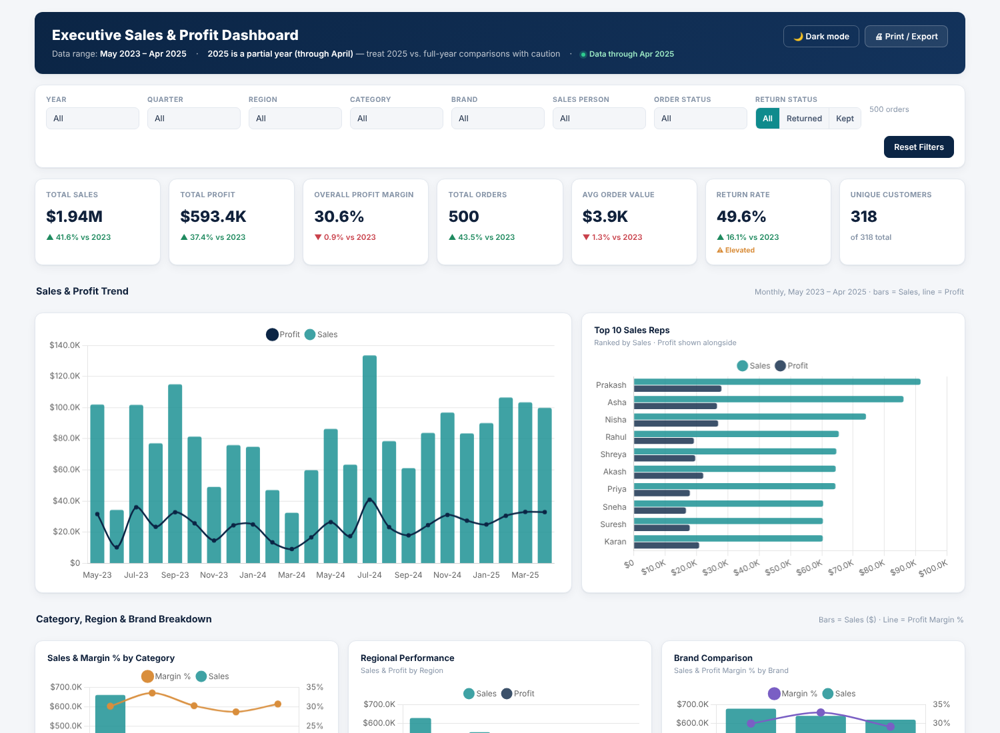

# Executive Sales & Profit Dashboard

A single-file, fully interactive HTML dashboard built for senior management to get a 5-second read on business health — then drill into specifics. No build step, no server, no dependencies beyond two CDN scripts (Chart.js + Inter font). Opens directly in any browser.

**[View the live dashboard →](https://lidianarhoro88.github.io/sales-profit-executive-dashboard/)**

## What it does

Built on 500 order-level transactions (May 2023 – Apr 2025) covering 318 customers, 18 SKUs, 39 sales reps, and 4 regions.

- **7 live KPI cards** — Total Sales, Total Profit, Overall Margin %, Orders, AOV, Return Rate, Unique Customers — with YoY trend indicators that recalculate instantly as filters change
- **7 charts** (Chart.js): monthly Sales/Profit trend, Top 10 reps by sales, Category sales vs. margin, Regional performance, Brand comparison, Discount % vs. Margin % correlation scatter, and an operational-health donut panel (order status / payment mode / return status)
- **8 client-side filters** — Year, Quarter, Region, Category, Brand, searchable Sales Person, Order Status, Return Status — all filtering the KPIs and charts simultaneously, with a Reset button
- **Key Insights panel** — six findings (growth trajectory, return-rate risk, margin vs. revenue leaders, discounting's effect on margin, regional imbalance, rep performance spread) computed dynamically from whatever is currently filtered, phrased as recommendations for leadership rather than raw stats
- Sortable, paginated, collapsible order-detail table
- Light/dark mode toggle, print-friendly layout, fully responsive down to mobile

## Headline numbers (unfiltered)

| Metric | Value |
|---|---|
| Total Sales | ≈ $1,936,313 |
| Total Profit | ≈ $593,391 |
| Overall Margin | ≈ 30.6% |
| Orders | 500 |
| Avg Order Value | ≈ $3,873 |
| Return Rate | ≈ 49.6% |

## Tech

- Vanilla JS, no framework — custom `Dashboard` class driving filter state, KPI recalculation, and chart updates
- [Chart.js](https://www.chartjs.org/) v4 via CDN for all charts (combo bar+line, scatter, doughnut)
- Dataset embedded inline as a JSON array — the dashboard works fully offline once loaded
- Single `.html` file, ~300KB including the full dataset

## Run it locally

Just open `index.html` in a browser — no installation needed.

## Data

Source: `Ultimate_Sales_Profit_Dataset.xlsx` — 500 synthetic order-level retail transactions with sales, cost, discount, region, product, rep, and return fields. 2025 is a partial year (through April only); the dashboard flags this wherever 2025 is compared to full years.
